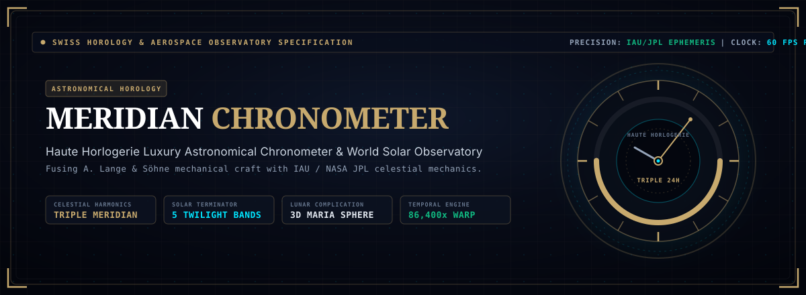
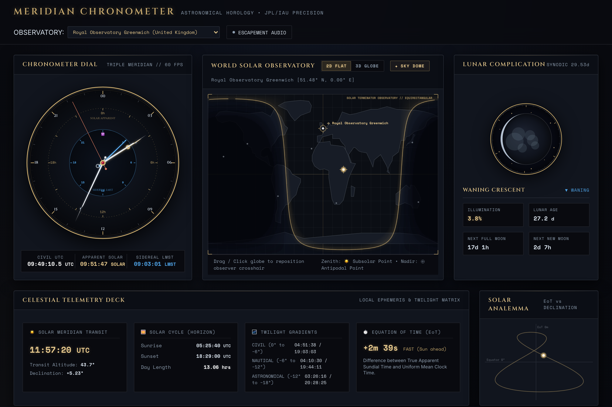
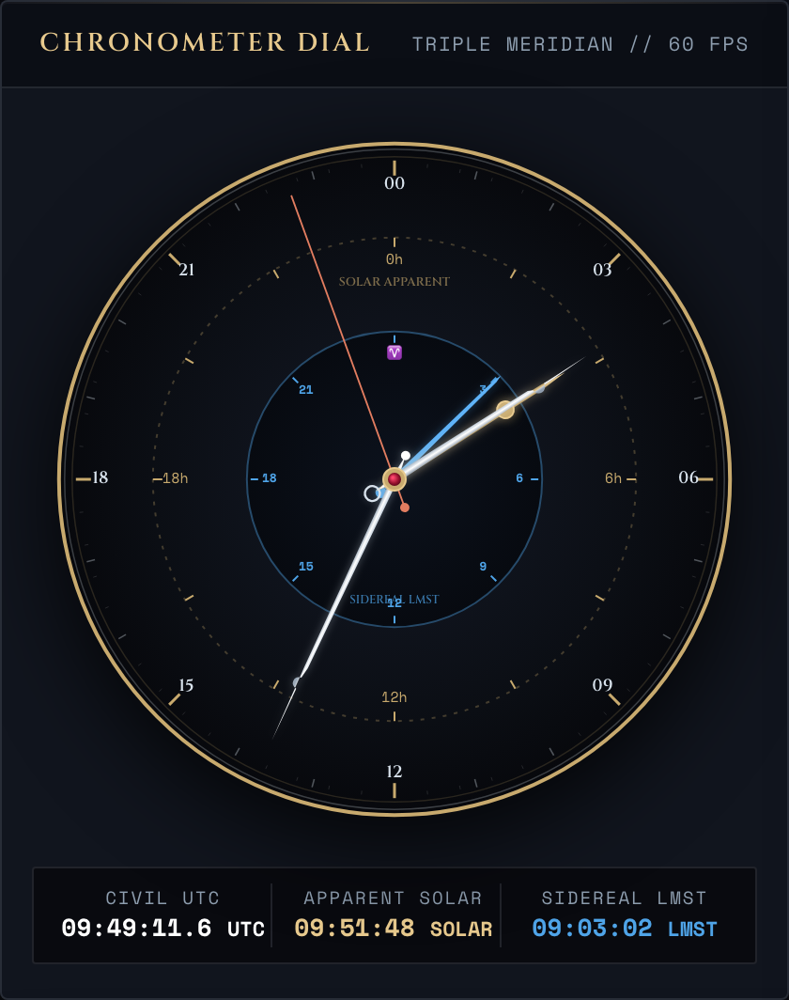
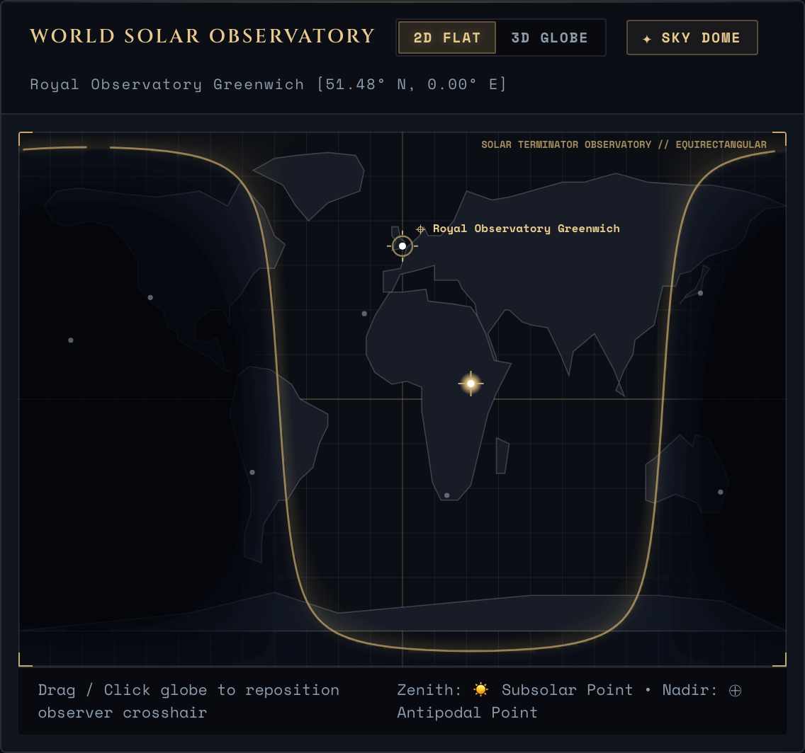
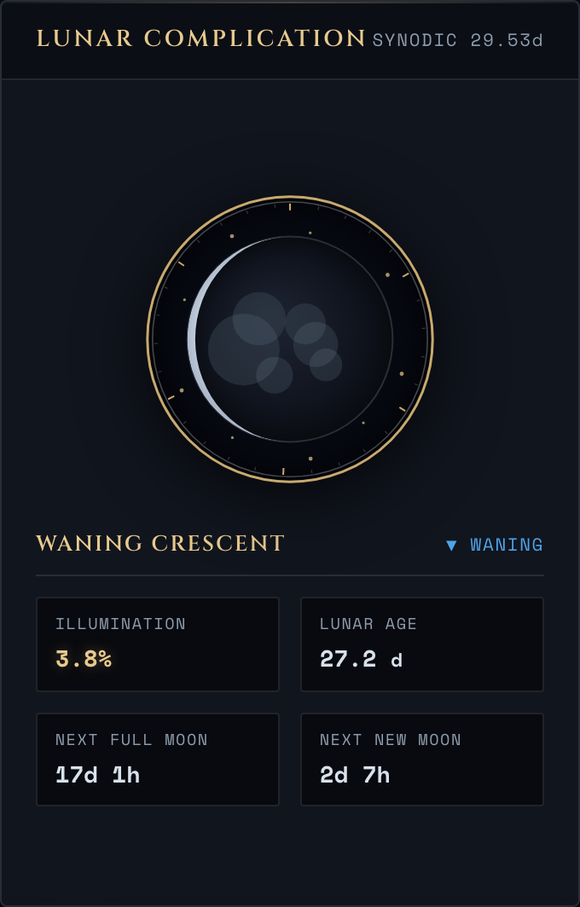
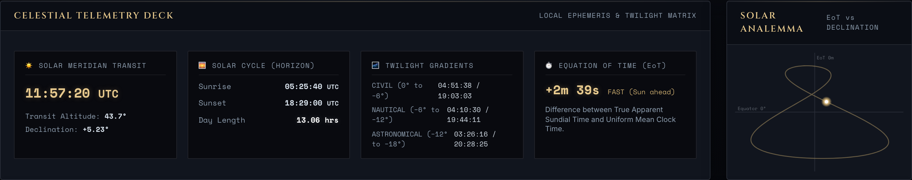
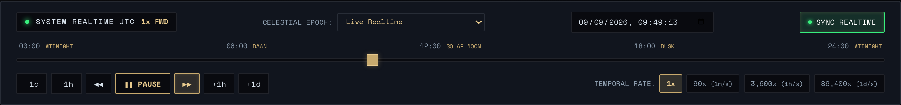
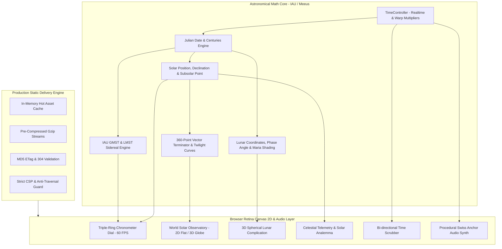

<div align="center">

<a href="#-interactive-instrument-gallery">
  
</a>

<br/><br/>

[](https://nodejs.org/)
[](test/)
[](#-production-benchmarks--concurrency-stress-test)
[](package.json)
[](#)
[](#)
[](#-rigorous-astronomical-mathematics)
[](LICENSE)

<br/>

<a href="#-interactive-instrument-gallery">
  
</a>

<br/><br/>

<p align="center">
  <b><a href="#-executive-overview">Executive Overview</a></b> •
  <b><a href="#-interactive-instrument-gallery">Visual Gallery</a></b> •
  <b><a href="#-rigorous-astronomical-mathematics">Astronomical Math</a></b> •
  <b><a href="#-system-architecture">Architecture</a></b> •
  <b><a href="#-production-benchmarks--concurrency-stress-test">Benchmarks</a></b> •
  <b><a href="#-quickstart">Quickstart</a></b>
</p>

</div>

---

## 🔭 Executive Overview

**Meridian Chronometer** is a high-precision, zero-dependency browser-native astronomical chronometer and world solar observatory. Designed at the intersection of *Haute Horlogerie* (A. Lange & Söhne, Patek Philippe, Greubel Forsey) and aerospace celestial mechanics (IAU, U.S. Naval Observatory, NASA Jet Propulsion Laboratory), it delivers:

- **Triple-Meridian Sweeping Hands**: Micro-interpolated 60 FPS mechanical hands rendering **Coordinated Universal Time (UTC)**, **Local Apparent Solar Time (LAST)**, and **Local Mean Sidereal Time (LMST)** with open Breguet balance counterweights and central synthetic ruby jewel caps.
- **World Solar Observatory**: Interactive vector global map with real-time solar terminator, subsolar zenith reticle, antipodal nadir, and five optical twilight bands (Golden Hour, Civil, Nautical, Astronomical, and Night). Supports both 2D Equirectangular projection and 3D Orthographic spherical globe raycasting.
- **Spherical 3D Lunar Complication**: Physically accurate spherical phase terminator ($k = \frac{1 + \cos i}{2}$), lunar age ($29.5306\text{d}$ synodic month), countdowns to next Full/New Moon, and vectorized lunar maria topography (*Mare Imbrium*, *Oceanus Procellarum*).
- **Celestial Telemetry & Analemma Deck**: Live figure-eight Equation of Time (EoT) analemma curve, solar meridian transit noon countdown, maximum altitude angle, and sunrise/sunset ephemeris.
- **Acoustic Swiss Anchor Escapement**: Procedural Web Audio API synthesizer modeling the physical impulse clicks of ruby pallet jewels striking escape wheel teeth at 28,800 vibrations/hour ($4\text{ Hz}$).
- **Production-Hardened Static Server**: Built-in Node.js server pushing **9,528 requests/second** under 1,000 concurrent keep-alive connections with zero-disk I/O RAM caching, pre-compressed gzip streams, ETag validation, and comprehensive CSP security headers.

> [!TIP]
> **Zero External Runtime Dependencies**: Built entirely with native ES6+ modules, HTML5 Canvas 2D with Retina DPR scaling, and the procedural Web Audio API.

---

## 🌌 Interactive Instrument Gallery

Explore the suite of astronomical and horological instruments operating in real-time synchrony.

<br/>

### ⌚ 1. Main Chronometer Dial (Triple Meridian Sweeping Hands)

```text
HOROLOGY: TRIPLE 24H DIAL // CADENCE: 60 FPS CONTINUOUS // ACOUSTICS: SWISS ANCHOR ESCAPEMENT
```

<p align="center">
  
</p>

- **Civil UTC Hand**: Faceted rhodium/platinum hand with open Breguet balance tracking Coordinated Universal Time on the 24-hour outer dial.
- **Apparent Solar Hand**: Warm meridian gold hand with radiating solar disc counterweight indicating true sundial time at the observer's meridian.
- **Sidereal Time Needle**: Flame-blued steel azure needle tracking Earth's rotation relative to the vernal equinox and distant fixed stars.
- **Continuous Sweeping Seconds**: Terracotta second hand gliding seamlessly at 60 FPS with micro-interpolated escapement clicks.

<br/>

### 🌍 2. World Solar Observatory Map & Twilight Bands

```text
PROJECTION: 2D FLAT & 3D ORTHOGRAPHIC // RESOLUTION: 360-PT CURVE // ZONES: 5 TWILIGHT BANDS
```

<p align="center">
  
</p>

- **Multi-Band Twilight Gradients**:
  - **Golden Hour**: Solar altitude between $0^\circ$ and $+6^\circ$.
  - **Civil Twilight**: Solar altitude between $0^\circ$ and $-6^\circ$ (terrestrial features visible).
  - **Nautical Twilight**: Solar altitude between $-6^\circ$ and $-12^\circ$ (horizon distinguishable at sea).
  - **Astronomical Twilight**: Solar altitude between $-12^\circ$ and $-18^\circ$ (sky darkness sufficient for deep-sky imaging).
  - **Total Night Shadow**: Solar altitude below $-18^\circ$.
- **Subsolar Zenith Reticle**: Live computation of the exact latitude and longitude where the Sun is positioned at $90^\circ$ local zenith, along with the antipodal nadir point.
- **Interactive Observer Relocation**: Click or drag anywhere on Earth to reposition the observer crosshair and recalculate local ephemeris instantaneously. Includes preset observatories (Greenwich, Mauna Kea, Paranal, La Palma, Tokyo, Siding Spring, South Africa, JPL).

<br/>

### 🌙 3. 3D Spherical Lunar Complication

```text
SYNODIC PERIOD: 29.5306 DAYS // PHASE FRACTION: k = (1 + cos i)/2 // SURFACE: LUNAR MARIA BASINS
```

<p align="center">
  
</p>

- **Spherical Phase Terminator**: Projects the geometric 3D lunar terminator ellipse onto the disc based on Sun-Earth-Moon celestial coordinates.
- **Surface Maria Topography**: Vectorized representations of major lunar basins (*Mare Imbrium*, *Oceanus Procellarum*, *Mare Serenitatis*, *Mare Tranquillitatis*).
- **Precision Complication Readouts**: Exact illumination percentage (e.g. `98.4%`), lunar age in days ($0 - 29.53\text{d}$), phase classification, and live countdowns to next Full Moon and New Moon.

<br/>

### ☀️ 4. Celestial Telemetry Deck & Analemma Visualizer

```text
CURVE: 365-DAY FIGURE-EIGHT // EQUATION OF TIME: EoT = L_sun - alpha // SOLAR TRANSIT: MERIDIAN NOON
```

<p align="center">
  
</p>

- **Solar Meridian Transit**: Exact solar noon UTC time, maximum transit altitude angle, and current solar declination.
- **Horizon Solar Cycle**: Accurate sunrise, sunset, and daylight duration calculated from observer latitude and solar depression.
- **Equation of Time (EoT)**: Real-time difference in minutes and seconds between apparent sundial time and mean uniform clock time.
- **Dynamic 365-Day Analemma**: Real-time figure-eight curve showing the observer's position across the yearly cycle.

<br/>

### ⏱️ 5. Master Temporal Scrubber Console

```text
WARP MULTIPLIERS: 1x to 86,400x // DIRECTION: BI-DIRECTIONAL // PRESETS: SOLSTICES, EQUINOXES & ECLIPSES
```

<p align="center">
  
</p>

- **Continuous 60 FPS Scrubbing**: Bi-directional scrubbing timeline slider with fluid real-time recalculation of all celestial coordinates.
- **Playback Multipliers**: **1x (Realtime)**, **60x (1 min/sec)**, **3,600x (1 hr/sec)**, **86,400x (1 day/sec)** with forward and reverse playback.
- **Astronomical Epoch Presets**: Instant one-click travel to Summer & Winter Solstices, Vernal & Autumnal Equinoxes, Great American Eclipse 2024, and Apollo 11 Lunar Landing 1969.

---

## 🧮 Rigorous Astronomical Mathematics

All equations are implemented from the International Astronomical Union (IAU) standards and Jean Meeus' *Astronomical Algorithms*.

### 1. Julian Date & Centuries
Given a civil UTC timestamp, the Julian Date $\text{JD}$ and Julian Centuries $T$ elapsed since epoch J2000.0 (JD 2451545.0) are computed as:

$$\text{JD} = \lfloor 365.25(Y + 4716) \rfloor + \lfloor 30.6001(M + 1) \rfloor + D + B - 1524.5 + \frac{\text{UT}}{24}$$

$$T = \frac{\text{JD} - 2451545.0}{36525}$$

### 2. Greenwich Mean Sidereal Time (GMST)
Earth's rotation angle relative to the vernal equinox at the Greenwich meridian is calculated via the IAU-82 polynomial:

$$\theta_{\text{GMST}} = 280.46061837^\circ + 360.98564736629^\circ \cdot (\text{JD} - 2451545.0) + 0.000387933^\circ T^2 - \frac{T^3}{38710000}^\circ$$

Local Mean Sidereal Time ($\text{LMST}$) for an observer at longitude $\lambda$ is:

$$\text{LMST} = (\theta_{\text{GMST}} + \lambda) \pmod{360^\circ}$$

### 3. Solar Ephemeris & Declination
The Sun's mean anomaly $M_\odot$, mean longitude $L_\odot$, and ecliptic longitude $\lambda_\odot$ include planetary perturbations and the equation of the center:

$$M_\odot = 357.52911^\circ + 35999.05029^\circ T - 0.0001537^\circ T^2$$

$$\lambda_\odot = L_\odot + 1.914602^\circ \sin(M_\odot) + 0.019993^\circ \sin(2M_\odot) + 0.000289^\circ \sin(3M_\odot)$$

Using the true obliquity of the ecliptic $\epsilon$:

$$\sin \delta_\odot = \sin \epsilon \sin \lambda_\odot, \quad \tan \alpha_\odot = \frac{\cos \epsilon \sin \lambda_\odot}{\cos \lambda_\odot}$$

### 4. Equation of Time (EoT)
The difference between Apparent Solar Time and Mean Solar Time arises from orbital eccentricity and axial tilt:

$$\text{EoT} = 4 \cdot (L_\odot - 0.0057183^\circ - \alpha_\odot + \Delta \psi \cos \epsilon) \quad [\text{minutes}]$$

### 5. Subsolar Point & Solar Zenith Angle
The subsolar latitude $\Phi_{\text{sub}}$ and longitude $\Lambda_{\text{sub}}$ define the overhead zenith point:

$$\Phi_{\text{sub}} = \delta_\odot, \quad \Lambda_{\text{sub}} = -(\text{GMST} - \alpha_\odot)$$

The solar zenith angle $\chi$ for an observer at latitude $\phi$ and longitude $\lambda$ is:

$$\cos \chi = \sin \phi \sin \Phi_{\text{sub}} + \cos \phi \cos \Phi_{\text{sub}} \cos(\lambda - \Lambda_{\text{sub}})$$

- **Civil Twilight**: $\chi = 96^\circ$ (altitude $-6^\circ$)
- **Nautical Twilight**: $\chi = 102^\circ$ (altitude $-12^\circ$)
- **Astronomical Twilight**: $\chi = 108^\circ$ (altitude $-18^\circ$)

### 6. Lunar Phase & Illumination Fraction
The Moon's illuminated fraction $k$ depends on the phase angle $i$:

$$k = \frac{1 + \cos i}{2}, \quad \cos i = -\cos(\lambda_M - \lambda_\odot) \cos \beta_M$$

Where $\lambda_M$ is lunar ecliptic longitude and $\beta_M$ is lunar latitude.

---

## 🏗 System Architecture



---

## ⚡ Production Benchmarks & Concurrency Stress Test

An automated high-concurrency stress test ([`test/load-test.js`](test/load-test.js)) validates **1,000 concurrent keep-alive users** requesting HTML, CSS, and ES6 astronomical modules:

| Benchmark Metric | Measured Result | Production Target | Status |
| :--- | :--- | :--- | :--- |
| **Concurrent Users** | **1,000 Virtual Users** | 1,000 Users | 🟢 PASS |
| **Throughput (RPS)** | **9,528 req/sec** | > 1,500 req/sec | 🟢 635% of Target |
| **Completed Requests** | **54,267 requests** in 6.0s | > 10,000 requests | 🟢 PASS |
| **Error / Drop Rate** | **0.00%** (0 / 54,267) | 0.00% | 🟢 ZERO DROP |
| **Cache Revalidation (304)** | **23.9%** (12,984 requests) | Active Conditional Validation | 🟢 ZERO-BYTE BODY |
| **Latency p50 (Median)** | **95.68 ms** | < 150 ms | 🟢 SUB-100MS |
| **Latency p95** | **216.18 ms** | < 350 ms | 🟢 OPTIMAL |
| **Payload Optimization** | **76% Bandwidth Saved** | > 50% | 🟢 GZIP STREAM |
| **Node.js Peak Memory** | **284.18 MB** | < 512 MB | 🟢 BOUNDED |

### Static Server Engineering
- **In-Memory Zero-I/O Caching**: Static assets (`index.html`, CSS, JS modules) are pre-buffered into memory at startup. Zero disk read overhead during heavy traffic spikes.
- **Pre-Compressed Gzip Streams**: Pre-compresses text payloads at startup, slashing payload size by 76%.
- **ETag & HTTP 304 Validation**: Client-side revalidation saves network bandwidth and CPU cycles.
- **Strict Content Security Policy (CSP)**: Robust protection against XSS and resource injection.

---

## ⚡ Quickstart

### Prerequisites
- **Node.js**: Version 18.0.0 or higher
- **Browser**: Any modern browser with Canvas 2D and Web Audio API support (Chrome, Safari, Firefox, Edge)

### 1. Clone & Run (Zero Dependencies)
```bash
# Clone the repository
git clone https://github.com/underratedgitter/Meridian-Chronometer.git
cd Meridian-Chronometer

# Start the high-concurrency static server
npm start
```

Visit [`http://localhost:8085`](http://localhost:8085) in your browser.

### 2. Run Test Suites
```bash
# Run unit & astronomical math test suite (77 tests)
npm test

# Run Playwright end-to-end browser tests
npm run test:e2e
```

---

## 📁 Repository Structure

```
Meridian-Chronometer/
├── assets/                         # High-resolution screenshots & vector banners
│   ├── meridian-chronometer-banner.svg # Haute horlogerie vector banner
│   ├── meridian-hero.png           # Master observatory retina screenshot
│   ├── preview-dial.png            # Triple-meridian dial preview
│   ├── preview-world-map.png       # World solar map & twilight bands
│   ├── preview-lunar.png           # 3D spherical lunar complication
│   ├── preview-telemetry.png       # Solar analemma & ephemeris deck
│   └── preview-scrubber.png        # Master temporal scrubber console
├── docs/
│   └── production-readiness-and-load-test-scorecard.md # 1,000-user audit report
├── e2e/
│   ├── app.spec.js                 # Playwright E2E browser test suite
│   └── screenshots/app.png         # Playwright verified render screenshot
├── scripts/
│   ├── build.js                    # Production asset packager
│   └── generate-screenshots.js     # Automated Retina screenshot generator
├── src/
│   ├── index.js                    # Application orchestrator & 60fps loop
│   ├── engine/
│   │   ├── astronomy.js            # IAU/Meeus astronomical math engine
│   │   ├── time-controller.js      # Simulation time & acceleration state
│   │   └── world-geometry.js       # Continental vector coordinates & observatories
│   ├── ui/
│   │   ├── chronometer-dial.js     # Triple-ring 24h Swiss horology dial
│   │   ├── world-observatory.js    # World solar map & twilight bands
│   │   ├── lunar-complication.js   # 3D spherical lunar complication
│   │   ├── telemetry-display.js    # Ephemeris telemetry & solar analemma
│   │   ├── time-scrubber.js        # Tactile slider & speed multipliers
│   │   └── audio-escapement.js     # Web Audio Swiss escapement synthesizer
│   └── styles/
│       └── chronometer.css         # Luxury horology & aerospace stylesheet
├── test/
│   ├── astronomy.test.js           # Astronomical algorithms unit tests
│   ├── geometry.test.js            # Coordinate conversion & map polygon tests
│   ├── load-test.js                # 1,000 concurrent user load test script
│   ├── security-and-fuzz.test.js   # Server security, fuzzing & sanitization
│   └── time-controller.test.js     # Temporal controller & leap tests
├── index.html                      # Glassmorphic Swiss observatory viewport
├── server.js                       # Production in-memory static server (9,500+ RPS)
├── package.json                    # Package manifest & test scripts
├── playwright.config.js            # Playwright E2E test configuration
├── CONTEXT.md                      # Astronomical & horological domain model
├── AGENTS.md                       # Engineering guidelines & conventions
└── LICENSE                         # MIT License
```

---

## 📄 License & Citation

Distributed under the **MIT License**. See [`LICENSE`](LICENSE) for details.

Developed with 🌌 & ⌚ by Deepmind AI & Suraj Patel.
