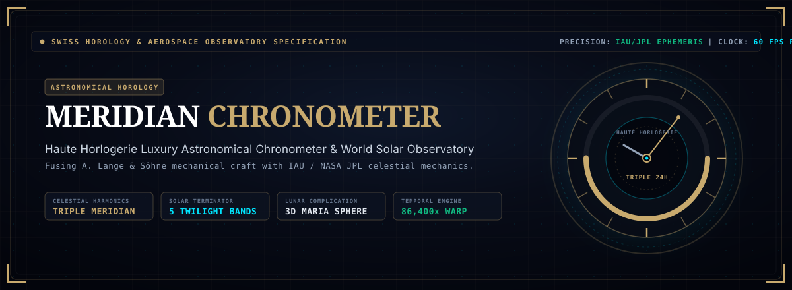
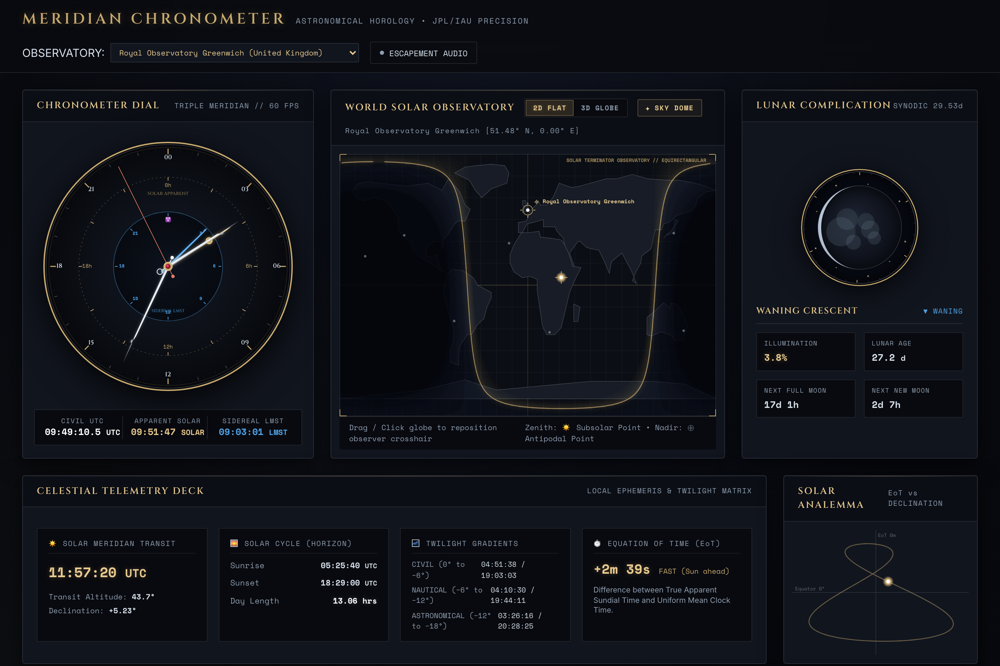
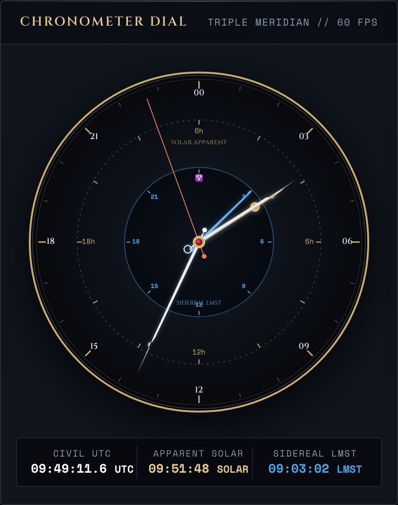
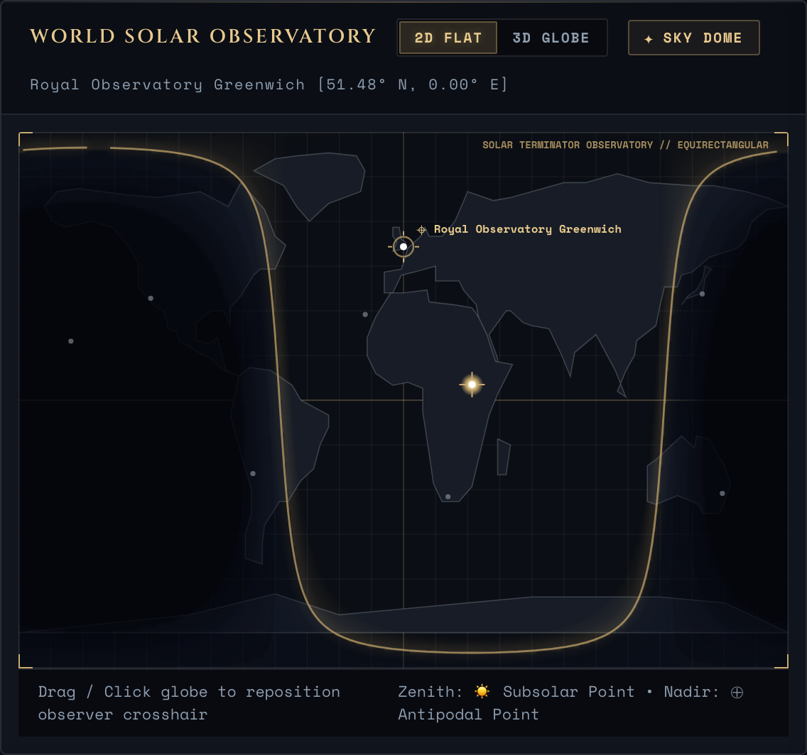
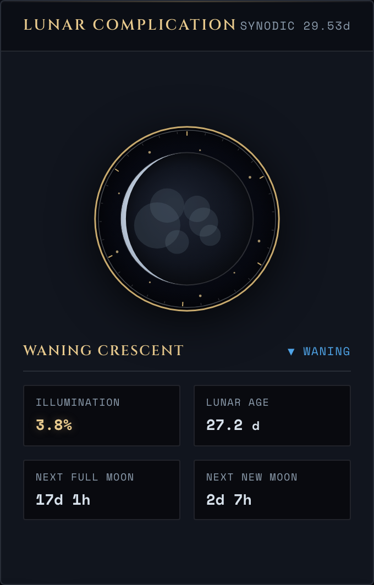
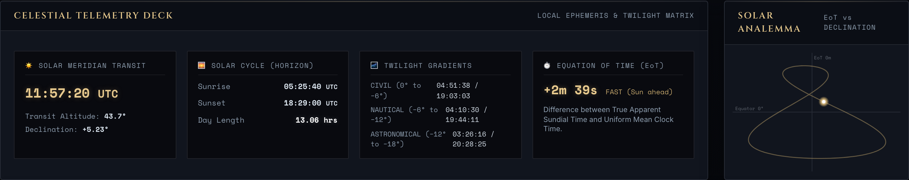
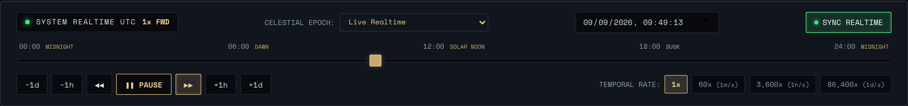
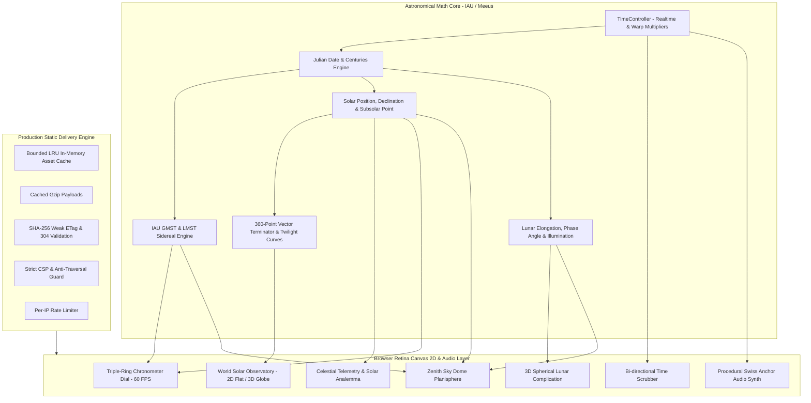

<div align="center">

<a href="#-interactive-instrument-gallery">
  
</a>

<br/><br/>

[](https://nodejs.org/)
[](test/)
[-f59e0b?style=for-the-badge&logo=speedtest&logoColor=white)](#-production-benchmarks--concurrency-stress-test)
[](package.json)
[](#)
[](#)
[](#-rigorous-astronomical-mathematics)
[](package.json)

<br/>

<a href="#-interactive-instrument-gallery">
  
</a>

<br/><br/>

<p align="center">
  <b><a href="#-executive-overview">Executive Overview</a></b> •
  <b><a href="#-interactive-instrument-gallery">Visual Gallery</a></b> •
  <b><a href="#-rigorous-astronomical-mathematics">Astronomical Math</a></b> •
  <b><a href="#-system-architecture">Architecture</a></b> •
  <b><a href="#-production-benchmarks--concurrency-stress-test">Benchmarks</a></b> •
  <b><a href="#-quickstart">Quickstart</a></b>
</p>

</div>

---

## 🔭 Executive Overview

**Meridian Chronometer** is a high-precision, zero-dependency browser-native astronomical chronometer and world solar observatory. Designed at the intersection of *Haute Horlogerie* (A. Lange & Söhne, Patek Philippe, Greubel Forsey) and aerospace celestial mechanics (IAU, U.S. Naval Observatory, NASA Jet Propulsion Laboratory), it delivers:

- **Triple-Meridian Sweeping Hands**: Micro-interpolated 60 FPS mechanical hands rendering **Coordinated Universal Time (UTC)**, **Local Apparent Solar Time (LAST)**, and **Local Mean Sidereal Time (LMST)**, plus UTC minute and sweeping seconds hands, with open Breguet balance counterweights and a central synthetic ruby jewel cap.
- **World Solar Observatory**: Interactive vector global map with real-time solar terminator, subsolar zenith reticle, antipodal nadir, and five optical twilight bands on the flat map (Golden Hour, Civil, Nautical, Astronomical, and Night). Supports both 2D Equirectangular projection and 3D Orthographic spherical globe raycasting.
- **Spherical 3D Lunar Complication**: Physically accurate spherical phase terminator ($k = \frac{1 + \cos i}{2}$), lunar age ($29.5306\text{d}$ synodic month), countdowns to next Full/New Moon, and vectorized lunar maria topography (*Mare Imbrium*, *Oceanus Procellarum*).
- **Celestial Telemetry & Analemma Deck**: Live figure-eight Equation of Time (EoT) analemma curve, solar noon (meridian transit) time, transit altitude, sunrise/sunset, day length, and civil/nautical/astronomical dawn and dusk.
- **Zenith Sky Dome Planisphere**: A local horizon sky-dome modal plotting bright navigation stars, Venus, Mars, Jupiter, the Sun and the Moon for the selected observer.
- **Acoustic Swiss Anchor Escapement**: Optional procedural Web Audio API synthesizer (no audio files) that plays an alternating tick/tock click on every simulated-second boundary.
- **Production-Hardened Static Server**: Built-in Node.js server with a bounded in-memory asset cache, cached gzip payloads, weak ETag / `304` validation, a public-path allowlist, per-IP rate limiting, and strict CSP security headers. It measured **9,528 requests/second** under 1,000 concurrent keep-alive connections in a September 2026 run that predates the rate limiter (see [Benchmarks](#-production-benchmarks--concurrency-stress-test)).

> [!TIP]
> **Zero External Runtime Dependencies**: Written as native ES modules, HTML5 Canvas 2D with Retina DPR scaling, and the procedural Web Audio API. A zero-dependency build script concatenates the modules into `dist/bundle.js`, which is what `index.html` loads. The only npm package is the `@playwright/test` dev dependency used for E2E tests.

---

## 🌌 Interactive Instrument Gallery

Explore the suite of astronomical and horological instruments operating in real-time synchrony.

<br/>

### ⌚ 1. Main Chronometer Dial (Triple Meridian Sweeping Hands)

```text
HOROLOGY: TRIPLE 24H DIAL // CADENCE: 60 FPS CONTINUOUS // ACOUSTICS: SWISS ANCHOR ESCAPEMENT
```

<p align="center">
  
</p>

- **Civil UTC Hand**: Faceted rhodium/platinum hand with open Breguet balance tracking Coordinated Universal Time on the 24-hour outer dial.
- **Apparent Solar Hand**: Warm meridian gold hand with radiating solar disc counterweight indicating true sundial time at the observer's meridian.
- **Sidereal Time Needle**: Flame-blued steel azure needle tracking Earth's rotation relative to the vernal equinox and distant fixed stars.
- **60-Minute Hand**: Slender faceted Breguet platinum hand tracking UTC minutes.
- **Continuous Sweeping Seconds**: Terracotta second hand gliding seamlessly at 60 FPS, with an optional escapement click on each second.

<br/>

### 🌍 2. World Solar Observatory Map & Twilight Bands

```text
PROJECTION: 2D FLAT & 3D ORTHOGRAPHIC // RESOLUTION: 360-PT CURVE // ZONES: 5 TWILIGHT BANDS
```

<p align="center">
  
</p>

- **Multi-Band Twilight Gradients** (2D flat map; the 3D globe folds astronomical twilight into night):
  - **Golden Hour**: Solar altitude between $0^\circ$ and $+6^\circ$.
  - **Civil Twilight**: Solar altitude between $0^\circ$ and $-6^\circ$ (terrestrial features visible).
  - **Nautical Twilight**: Solar altitude between $-6^\circ$ and $-12^\circ$ (horizon distinguishable at sea).
  - **Astronomical Twilight**: Solar altitude between $-12^\circ$ and $-18^\circ$ (sky darkness sufficient for deep-sky imaging).
  - **Total Night Shadow**: Solar altitude below $-18^\circ$.
- **Subsolar Zenith Reticle**: Live computation of the exact latitude and longitude where the Sun is positioned at $90^\circ$ local zenith, along with the antipodal nadir point.
- **Interactive Observer Relocation**: Click anywhere on Earth to reposition the observer crosshair, recalculate local ephemeris and open the sky dome; drag to rotate the 3D globe. Includes preset observatories (Greenwich, Mauna Kea, Paranal, La Palma, Tokyo, Siding Spring, South Africa, JPL).

<br/>

### 🌙 3. 3D Spherical Lunar Complication

```text
SYNODIC PERIOD: 29.5306 DAYS // PHASE FRACTION: k = (1 + cos i)/2 // SURFACE: LUNAR MARIA BASINS
```

<p align="center">
  
</p>

- **Spherical Phase Terminator**: Projects the geometric 3D lunar terminator ellipse onto the disc based on Sun-Earth-Moon celestial coordinates.
- **Surface Maria Topography**: Simplified shaded representations of major lunar basins (*Mare Imbrium*, *Oceanus Procellarum*, *Mare Serenitatis*, *Mare Tranquillitatis*).
- **Precision Complication Readouts**: Exact illumination percentage (e.g. `98.4%`), lunar age in days ($0 - 29.53\text{d}$), phase classification, and live countdowns to next Full Moon and New Moon.

<br/>

### ☀️ 4. Celestial Telemetry Deck & Analemma Visualizer

```text
CURVE: 365-DAY FIGURE-EIGHT // EQUATION OF TIME: EoT = L_sun - alpha // SOLAR TRANSIT: MERIDIAN NOON
```

<p align="center">
  
</p>

- **Solar Meridian Transit**: Exact solar noon UTC time, maximum transit altitude angle, and current solar declination.
- **Horizon Solar Cycle**: Sunrise, sunset, and day length calculated from observer latitude and solar depression.
- **Twilight Gradients**: Civil, nautical, and astronomical dawn and dusk times (UTC).
- **Equation of Time (EoT)**: Real-time difference in minutes and seconds between apparent sundial time and mean uniform clock time.
- **Dynamic 365-Day Analemma**: Figure-eight curve of Equation of Time against solar declination, with a beacon marking the current date in the yearly cycle.

<br/>

### ⏱️ 5. Master Temporal Scrubber Console

```text
WARP MULTIPLIERS: 1x to 86,400x // DIRECTION: BI-DIRECTIONAL // PRESETS: SOLSTICES, EQUINOXES, ECLIPSE & APOLLO 11
```

<p align="center">
  
</p>

- **Continuous 60 FPS Scrubbing**: 24-hour diurnal timeline slider plus ±1 hour and ±1 day step buttons, with fluid real-time recalculation of all celestial coordinates.
- **Playback Multipliers**: **1x (Realtime)**, **60x (1 min/sec)**, **3,600x (1 hr/sec)**, **86,400x (1 day/sec)** with forward and reverse playback.
- **Astronomical Epoch Presets**: Instant one-click travel to Summer & Winter Solstices, Vernal & Autumnal Equinoxes, Great American Eclipse 2024, and Apollo 11 Lunar Landing 1969.

---

## 🧮 Rigorous Astronomical Mathematics

All equations are implemented from the International Astronomical Union (IAU) standards and Jean Meeus' *Astronomical Algorithms*.

### 1. Julian Date & Centuries
Given a civil UTC timestamp $t_{\text{ms}}$ (milliseconds since the Unix epoch), the Julian Date $\text{JD}$ and Julian Centuries $T$ elapsed since epoch J2000.0 (JD 2451545.0) are computed as:

$$\text{JD} = \frac{t_{\text{ms}}}{86400000} + 2440587.5$$

$$T = \frac{\text{JD} - 2451545.0}{36525}$$

### 2. Greenwich Mean Sidereal Time (GMST)
Earth's rotation angle relative to the vernal equinox at the Greenwich meridian is calculated via the IAU-82 polynomial:

$$\theta_{\text{GMST}} = 280.46061837^\circ + 360.98564736629^\circ \cdot (\text{JD} - 2451545.0) + 0.000387933^\circ T^2 - \frac{T^3}{38710000}^\circ$$

Local Mean Sidereal Time ($\text{LMST}$) for an observer at longitude $\lambda$ is:

$$\text{LMST} = (\theta_{\text{GMST}} + \lambda) \pmod{360^\circ}$$

### 3. Solar Ephemeris & Declination
The Sun's geometric mean longitude $L_\odot$, mean anomaly $M_\odot$, equation of the center $C$, and apparent ecliptic longitude $\lambda_\odot$ (corrected for nutation and aberration via the lunar node $\Omega$) follow Meeus:

$$L_\odot = 280.46646^\circ + 36000.76983^\circ T + 0.0003032^\circ T^2$$

$$M_\odot = 357.52911^\circ + 35999.05029^\circ T - 0.0001537^\circ T^2$$

$$C = (1.914602^\circ - 0.004817^\circ T - 0.000014^\circ T^2) \sin M_\odot + (0.019993^\circ - 0.000101^\circ T) \sin 2M_\odot + 0.000289^\circ \sin 3M_\odot$$

$$\Omega = 125.04^\circ - 1934.136^\circ T, \quad \lambda_\odot = L_\odot + C - 0.00569^\circ - 0.00478^\circ \sin \Omega$$

Using the obliquity of the ecliptic corrected for nutation, $\epsilon = \epsilon_0 + 0.00256^\circ \cos \Omega$:

$$\sin \delta_\odot = \sin \epsilon \sin \lambda_\odot, \quad \tan \alpha_\odot = \frac{\cos \epsilon \sin \lambda_\odot}{\cos \lambda_\odot}$$

### 4. Equation of Time (EoT)
The difference between Apparent Solar Time and Mean Solar Time arises from orbital eccentricity $e$ and axial tilt. With $y = \tan^2(\epsilon/2)$, Smart's series (Meeus eq. 28.3) gives, in radians:

$$E = y \sin 2L_\odot - 2e \sin M_\odot + 4ey \sin M_\odot \cos 2L_\odot - \tfrac{1}{2}y^2 \sin 4L_\odot - \tfrac{5}{4}e^2 \sin 2M_\odot$$

$$\text{EoT} = 4 \cdot E \cdot \frac{180^\circ}{\pi} \quad [\text{minutes}]$$

### 5. Subsolar Point & Solar Zenith Angle
The subsolar latitude $\Phi_{\text{sub}}$ and longitude $\Lambda_{\text{sub}}$ define the overhead zenith point, where apparent solar time is 12:00 ($\text{UT}$ in hours, $\text{EoT}$ in minutes):

$$\Phi_{\text{sub}} = \delta_\odot, \quad \Lambda_{\text{sub}} = -15^\circ \cdot \left(\text{UT} - 12 + \frac{\text{EoT}}{60}\right)$$

The solar zenith angle $\chi$ for an observer at latitude $\phi$ and longitude $\lambda$ is:

$$\cos \chi = \sin \phi \sin \Phi_{\text{sub}} + \cos \phi \cos \Phi_{\text{sub}} \cos(\lambda - \Lambda_{\text{sub}})$$

- **Golden Hour**: $\chi = 84^\circ$ (altitude $+6^\circ$)
- **Civil Twilight**: $\chi = 96^\circ$ (altitude $-6^\circ$)
- **Nautical Twilight**: $\chi = 102^\circ$ (altitude $-12^\circ$)
- **Astronomical Twilight**: $\chi = 108^\circ$ (altitude $-18^\circ$)

### 6. Lunar Phase & Illumination Fraction
The Moon's illuminated fraction $k$ depends on the phase angle $i$, computed from the Moon's mean elongation $D$, the Sun's mean anomaly $M$, and the Moon's mean anomaly $M'$ (Meeus eq. 48.4):

$$k = \frac{1 + \cos i}{2}$$

$$i = 180^\circ - D - 6.289^\circ \sin M' + 2.100^\circ \sin M - 1.274^\circ \sin(2D - M') - 0.658^\circ \sin 2D - 0.214^\circ \sin 2M' - 0.110^\circ \sin D$$

Lunar age and the countdowns to the next Full and New Moon are derived from $D$ and the mean synodic month ($29.530588853\text{d}$).

---

## 🏗 System Architecture



---

## ⚡ Production Benchmarks & Concurrency Stress Test

An automated high-concurrency stress test ([`test/load-test.js`](test/load-test.js)) drives **1,000 concurrent keep-alive users** for 6 seconds against `127.0.0.1` (port `PORT`, default `8085`), requesting HTML, CSS, and ES astronomical modules, and exits non-zero on any error. Start the server with `npm start`, then run `node test/load-test.js` in a second terminal.

> [!NOTE]
> The figures below were recorded on 2026-09-09 and are copied from [`docs/production-readiness-and-load-test-scorecard.md`](docs/production-readiness-and-load-test-scorecard.md). They have not been re-measured since. The per-IP rate limiter added afterwards (300 requests per 10 s in `server.js`) means a single-host run against the current server will receive `429` responses and the script will report errors.

| Benchmark Metric | Measured Result | Production Target | Status |
| :--- | :--- | :--- | :--- |
| **Concurrent Users** | **1,000 Virtual Users** | 1,000 Users | 🟢 PASS |
| **Throughput (RPS)** | **8,945 – 9,528 req/sec** | > 1,500 req/sec | 🟢 635% of Target |
| **Completed Requests** | **54,267 requests** in 6.0s | > 10,000 requests | 🟢 PASS |
| **Error / Drop Rate** | **0.00%** (0 / 54,267) | 0.00% | 🟢 ZERO DROP |
| **Cache Revalidation (304)** | **23.9%** (12,984 requests) | Active Conditional Validation | 🟢 ZERO-BYTE BODY |
| **Latency p50 (Median)** | **95.68 ms** | < 150 ms | 🟢 SUB-100MS |
| **Latency p95** | **216.18 ms** | < 350 ms | 🟢 OPTIMAL |
| **Payload Optimization** | **76% Bandwidth Saved** (149 KB → ~35 KB, from the scorecard; not measured by the script) | > 50% | 🟢 GZIP STREAM |
| **Load-Generator RSS** | **284.18 MB** (final RSS of the load-test process) | < 512 MB | 🟢 BOUNDED |

### Static Server Engineering
- **In-Memory Asset Caching**: Each asset is read from disk on its first request and then served from a bounded LRU cache (200 entries / 30 MiB), re-read only when its mtime or size changes.
- **Cached Gzip Payloads**: Text assets (`.html`, `.js`, `.css`, `.json`, `.svg`, `.map`) over 128 bytes are gzipped once on cache fill and served with `Content-Encoding: gzip`; at most 4 compressions run concurrently, beyond which the raw payload is served.
- **ETag & HTTP 304 Validation**: Weak ETags built from the file size and a SHA-256 content hash; `If-None-Match` (including `*` and lists) returns a zero-byte `304`.
- **Strict Content Security Policy (CSP)**: CSP, `X-Frame-Options: DENY`, `nosniff`, COOP/CORP/COEP, HSTS and related headers on every response.
- **Request Hardening**: `GET`/`HEAD` only, per-IP rate limiting (300 requests per 10 s, then `429`), 2,048-character URL cap, null-byte, traversal and symlink-escape rejection, dotfile blocking, and a public-path allowlist (`index.html`, `src/`, `dist/`, `assets/`; everything else is `403`).

---

## ⚡ Quickstart

### Prerequisites
- **Node.js**: Version 20 or higher (`@playwright/test` 1.65.0 requires Node.js ≥ 20; CI runs Node.js 24). `package.json` declares no `engines` field.
- **Browser**: Any modern browser with Canvas 2D and Web Audio API support (Chrome, Safari, Firefox, Edge)

### 1. Clone & Run (Zero Dependencies)
```bash
# Clone the repository
git clone https://github.com/underratedgitter/Meridian-Chronometer.git
cd Meridian-Chronometer

# Start the high-concurrency static server
npm start
```

Visit [`http://localhost:8085`](http://localhost:8085) in your browser. Set `PORT` to use another port (for example `PORT=9000 npm start`); if the port is taken, the server tries the next port up, up to 10 times.

### 2. Run Test Suites
```bash
# Run unit & astronomical math test suite (85 node:test cases, no install needed)
npm test

# Run Playwright end-to-end browser tests (needs the dev dependency and Chromium)
npm ci
npx playwright install chromium
npm run test:e2e
```

The E2E config starts `node server.js` on port `8085` (reusing an already running server outside CI). `BASE_URL` may point it at another `localhost` / `127.0.0.1` URL.

### 3. Build & Deploy
```bash
# Rebuild dist/bundle.js from src/ and refresh its SRI hash in index.html
npm run build

# Regenerate the README screenshots in assets/ (server must be running; uses BASE_URL, default http://127.0.0.1:8085)
node scripts/generate-screenshots.js
```

Run `npm run build` after editing anything in `src/`: the page loads `dist/bundle.js`, not the individual modules. The GitHub Actions workflow ([`.github/workflows/deploy.yml`](.github/workflows/deploy.yml)) runs `npm ci` and `npm test` on Node.js 24 for every push and pull request to `main`; pushes to `main` then rebuild the bundle and deploy `index.html`, `dist/`, `src/`, and `assets/` to GitHub Pages.

### Keyboard Shortcuts

| Key | Action |
| :--- | :--- |
| `Space` | Play / pause simulated time |
| `G` or `M` | Toggle 2D flat map / 3D globe |
| `D` | Open / close the zenith sky dome |
| `A` | Toggle escapement audio |
| `F` | Toggle fullscreen |

---

## 📁 Repository Structure

```
Meridian-Chronometer/
├── assets/                         # High-resolution screenshots & vector banners
│   ├── meridian-chronometer-banner.svg # Haute horlogerie vector banner
│   ├── meridian-hero.png           # Master observatory retina screenshot
│   ├── preview-dial.png            # Triple-meridian dial preview
│   ├── preview-world-map.png       # World solar map & twilight bands
│   ├── preview-lunar.png           # 3D spherical lunar complication
│   ├── preview-telemetry.png       # Solar analemma & ephemeris deck
│   └── preview-scrubber.png        # Master temporal scrubber console
├── .github/workflows/
│   └── deploy.yml                  # CI tests & GitHub Pages deployment
├── dist/
│   └── bundle.js                   # Standalone bundle loaded by index.html (npm run build)
├── docs/
│   └── production-readiness-and-load-test-scorecard.md # 1,000-user audit report
├── e2e/
│   ├── app.spec.js                 # Playwright E2E browser test suite
│   └── screenshots/app.png         # Playwright verified render screenshot
├── scripts/
│   ├── build.js                    # Production asset packager
│   └── generate-screenshots.js     # Automated Retina screenshot generator
├── src/
│   ├── index.js                    # Application orchestrator & 60fps loop
│   ├── engine/
│   │   ├── astronomy.js            # IAU/Meeus astronomical math engine
│   │   ├── sanitizer.js            # HTML escaping & prototype-pollution-safe merge
│   │   ├── time-controller.js      # Simulation time & acceleration state
│   │   └── world-geometry.js       # Continental vector coordinates & observatories
│   ├── ui/
│   │   ├── chronometer-dial.js     # Triple-ring 24h Swiss horology dial
│   │   ├── world-observatory.js    # World solar map & twilight bands
│   │   ├── lunar-complication.js   # 3D spherical lunar complication
│   │   ├── telemetry-display.js    # Ephemeris telemetry & solar analemma
│   │   ├── time-scrubber.js        # Tactile slider & speed multipliers
│   │   ├── sky-dome.js             # Zenith sky dome planisphere (stars & planets)
│   │   └── audio-escapement.js     # Web Audio Swiss escapement synthesizer
│   └── styles/
│       └── chronometer.css         # Luxury horology & aerospace stylesheet
├── test/
│   ├── astronomy.test.js           # Astronomical algorithms unit tests
│   ├── celestial-sphere.test.js    # Alt/az, orthographic projection & planet tests
│   ├── geometry.test.js            # Observatory, epoch & map polygon tests
│   ├── load-test.js                # 1,000 concurrent user load test script
│   ├── normalization.test.js       # normalizeDegrees & normalizeHours tests
│   ├── security-and-fuzz.test.js   # Math fuzzing, controller/audio stress & low-power mode
│   ├── server-security.test.js     # Static server hardening & sanitizer tests
│   └── time-controller.test.js     # Temporal controller playback tests
├── index.html                      # Glassmorphic Swiss observatory viewport
├── server.js                       # Production in-memory static server
├── package.json                    # Package manifest & test scripts
├── playwright.config.js            # Playwright E2E test configuration
├── CONTEXT.md                      # Astronomical & horological domain model
└── AGENTS.md                       # Engineering guidelines & conventions
```

---

## 📄 License & Citation

Declared under the **MIT License** in [`package.json`](package.json). The repository does not yet include a `LICENSE` file.

Developed with 🌌 & ⌚ by Deepmind AI & Suraj Patel.
